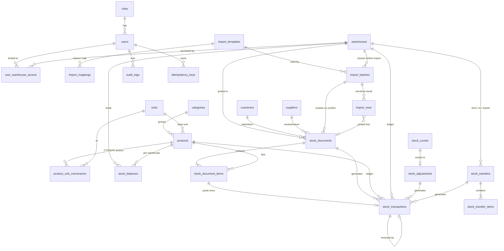
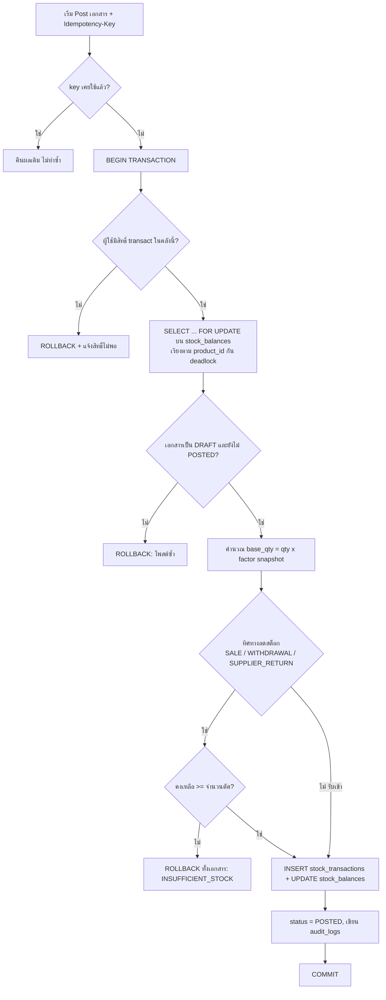
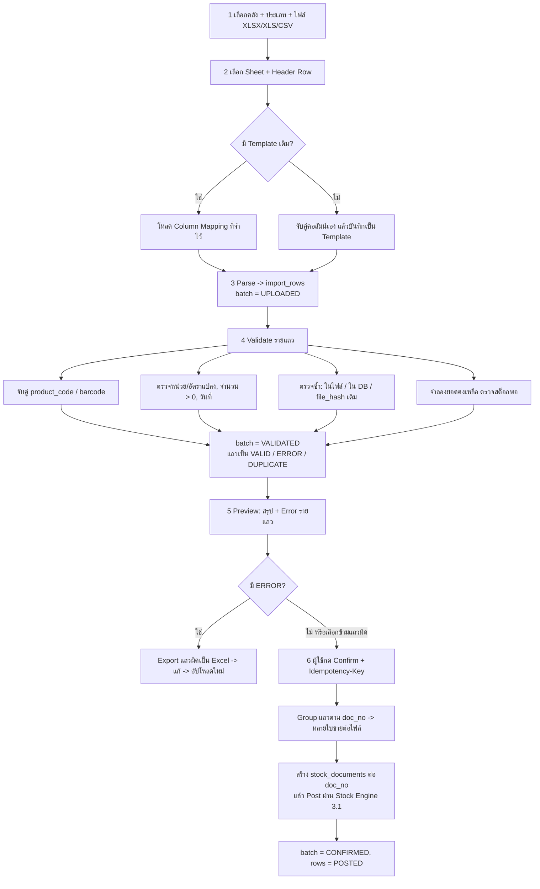
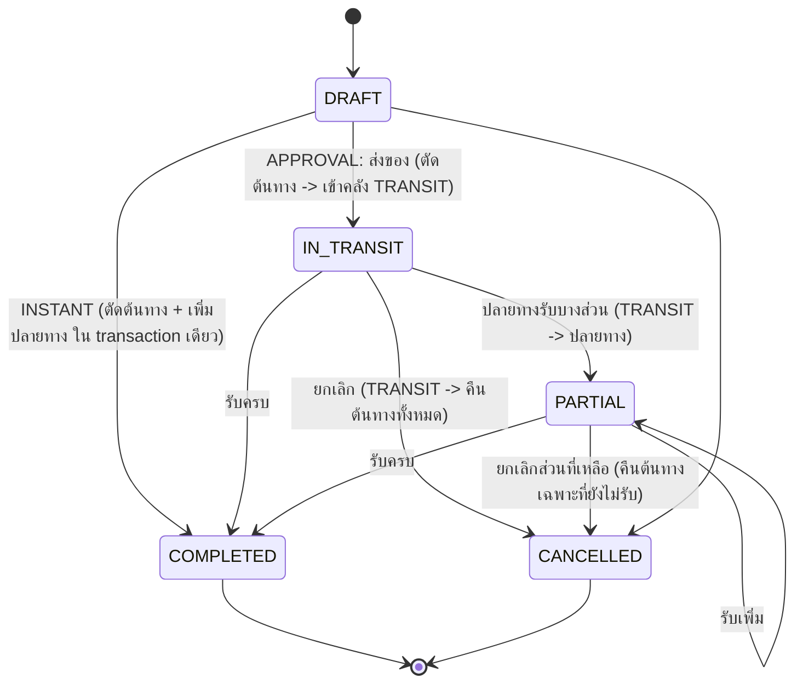

# Multi-Warehouse Auto Inventory — Design Review (ก่อนเริ่ม Phase 2)

ไฟล์ประกอบ: `01_schema.sql` (PostgreSQL 16, 24 ตาราง — โหลดและทดสอบผ่านแล้ว)

---

## 1. ER Diagram

### 1.1 ภาพรวมกลุ่มตาราง

### 1.2 แนวคิดสำคัญ (Source of truth)

| แนวคิด | วิธีออกแบบ |
|---|---|
| **Ledger เป็นแหล่งข้อมูลหลัก** | `stock_transactions` เป็น append-only (trigger บล็อก UPDATE/DELETE) ยอดคงเหลือใน `stock_balances` คือ cache ที่ต้องตรงกับผลรวม ledger ตรวจเทียบได้ตลอด |
| **หน่วยนับ** | เก็บทุกอย่างเป็น PC (base) เอกสารเก็บ `unit_id` + `qty` + `conversion_factor` (snapshot ณ วันที่ทำเอกสาร) + `base_qty` แก้อัตราแปลงภายหลังไม่กระทบเอกสารเก่า |
| **ไม่มีต้นทุน** | ไม่มีคอลัมน์ราคา/ต้นทุนในระบบ จัดการเฉพาะจำนวน |
| **กลับรายการ** | ไม่แก้/ลบ ledger — สร้างแถว `REVERSAL` ที่ชี้ `reverses_txn_id` (unique → กลับซ้ำไม่ได้) และเอกสารเดิมเป็น `REVERSED` |
| **คลังระหว่างทาง** | `warehouses.warehouse_type = 'TRANSIT'` (คลังเสมือน) สินค้าที่ส่งแล้วยังไม่รับจะอยู่ใน balance ของคลังนี้ ตรวจย้อนหลังได้ผ่าน `transfer_id` ใน ledger |

---

## 2. Database Schema (สรุป 24 ตาราง)

| กลุ่ม | ตาราง | หน้าที่ / กุญแจสำคัญ |
|---|---|---|
| **Master (7)** | `products` | `product_code` unique, `barcode` unique (partial) |
| | `categories` | ลำดับชั้นด้วย `parent_id` |
| | `units` | CT, PK, PC; มี base ได้ตัวเดียว (partial unique index) |
| | `product_unit_conversions` | unique (product, unit), `factor_to_base > 0`, barcode ต่อหน่วย |
| | `warehouses` | `PHYSICAL` / `TRANSIT` |
| | `customers`, `suppliers` | รหัสไม่ซ้ำ |
| **Stock Core (6)** | `stock_balances` | PK (warehouse, product); trigger กันติดลบ |
| | `stock_transactions` | ledger: qty_in/qty_out, `balance_after`, link เอกสาร/โอน/ปรับยอด |
| | `stock_documents` | ใบขาย/เบิก/รับเข้า/รับคืนลูกค้า/คืนซัพพลายเออร์/ปรับยอด; unique (type, warehouse, doc_no) |
| | `stock_document_items` | snapshot อัตราแปลง + base_qty |
| | `stock_counts` | ใบตรวจนับ (system_qty vs counted_qty) |
| | `stock_adjustments` | ผลต่างจากการนับ → ledger ADJUST_IN/OUT (1 ใบนับ ปรับได้ 1 ครั้ง) |
| **Import (4)** | `import_templates` | sheet, header row, match by code/barcode |
| | `import_mappings` | จับคู่คอลัมน์ Excel → field ระบบ (จำรูปแบบ) |
| | `import_batches` | คลังที่เลือก, `file_hash` กันอัปโหลดไฟล์เดิมซ้ำ, สถานะ |
| | `import_rows` | raw JSON, สถานะ/error รายแถว, `row_hash` กันแถวซ้ำ |
| **Transfer (2)** | `stock_transfers` | INSTANT / APPROVAL; DRAFT→IN_TRANSIT→PARTIAL→COMPLETED/CANCELLED |
| | `stock_transfer_items` | sent / received / cancelled (CHECK: received+cancelled ≤ sent) |
| **User (3)** | `users`, `roles` | RBAC (`permissions` JSONB) |
| | `user_warehouse_access` | สิทธิ์ราย-คลัง: view / transact / approve |
| **Audit (2)** | `audit_logs` | ใคร ทำอะไร ค่าเดิม/ใหม่ |
| | `idempotency_keys` | กดยืนยันซ้ำ/ส่ง request ซ้ำ ไม่ทำงานสองรอบ |

ผลทดสอบบน PostgreSQL 16 จริง: 24 ตาราง, 56 FK, 19 Unique, 67 Index

**กลไกกันข้อผิดพลาดที่ทดสอบแล้ว (10 กรณีผ่านครบ):** สต็อกติดลบถูกปฏิเสธ · ตัดสต็อกบรรทัดเดิมซ้ำถูกปฏิเสธ · แก้/ลบ ledger ถูกปฏิเสธ · กลับรายการซ้ำถูกปฏิเสธ · เลขเอกสารซ้ำถูกปฏิเสธ · base unit ซ้ำถูกปฏิเสธ · โอนเข้าคลังเดียวกันถูกปฏิเสธ · รับเกินที่ส่งถูกปฏิเสธ

---

## 3. Workflows

### 3.1 Stock Engine — การ Post เอกสาร (ทุกประเภท)

| เอกสาร | ทิศทาง |
|---|---|
| RECEIVING / CUSTOMER_RETURN | + |
| SALE / WITHDRAWAL / SUPPLIER_RETURN | − (ตรวจคงเหลือก่อน) |
| ADJUSTMENT (จากผลนับ) | + หรือ − ตาม diff |

**กลับรายการ:** เลือกเอกสาร POSTED → สร้างเอกสารกลับรายการ + แถว REVERSAL ตรงข้ามทุกบรรทัด → เอกสารเดิมเป็น REVERSED (ถ้ากลับแล้วทำให้สต็อกติดลบ จะถูกปฏิเสธ)

### 3.2 Excel Import (ห้ามตัดสต็อกก่อน Confirm)

หมายเหตุ: ถ้ามีเอกสารใดใน batch ตัดไม่ผ่าน (เช่น สต็อกไม่พอ) ทั้ง batch ถูก rollback ไม่มีสต็อกถูกตัดครึ่งๆ กลางๆ

### 3.3 Transfer ระหว่างคลัง

ledger ของแต่ละขั้น: ส่ง = `TRANSFER_OUT` (ต้นทาง) + `TRANSIT_IN` · รับ = `TRANSIT_OUT` + `TRANSFER_IN` (ปลายทาง) · ยกเลิก = `TRANSIT_OUT` + `TRANSFER_IN` (ต้นทาง) — ยอดในคลัง TRANSIT ต้องเป็น 0 เมื่อโอนครบ/ยกเลิก ใช้เป็นตัวตรวจสอบย้อนหลัง

---

## 4. ข้อสมมติฐานที่ผมตั้งไว้ — ขอให้ยืนยันหรือแก้

1. **ไม่อนุญาตสต็อกติดลบทุกกรณี** (ใบขายที่สต็อกไม่พอจะถูกปฏิเสธ ทั้งใบ/ทั้ง batch)
2. **Import แบบ all-or-nothing ต่อ batch** เมื่อกด Confirm (แถวผิดต้องแก้ก่อน หรือเลือก "ข้ามแถวผิด" ได้ก่อนยืนยัน)
3. **Customer Return / Supplier Return** ใช้ตาราง `stock_documents` เดียวกัน (แยกด้วย `doc_type`)
4. **คลังระหว่างทาง** ใช้ 1 คลังเสมือนทั้งระบบ (`TRANSIT`) แยกรายใบโอนด้วย `transfer_id` ใน ledger
5. **เลขเอกสาร** ซ้ำกันไม่ได้ภายในประเภท+คลัง ตอน Import ถ้าเลขใบขายในไฟล์ตรงกับที่เคย Post แล้วจะถูกทำเครื่องหมาย DUPLICATE
6. **ผู้ใช้ 1 คนมี 1 role** และกำหนดสิทธิ์รายคลังเพิ่ม (view / transact / approve)
7. **Tech stack ของ Phase 2 เป็นต้นไป** — ยังไม่ได้ตัดสินใจ ดูคำถามด้านล่าง

## 5. การตัดสินใจที่ยืนยันแล้ว (จากคอมเมนต์ของผู้ใช้)

- **Stack:** ให้ Claude เลือก → Python (FastAPI) + PostgreSQL + หน้าเว็บ JavaScript ธรรมดา (ไม่มี build step)
- **การใช้งาน:** deploy บนเซิร์ฟเวอร์/คลาวด์ → จัดชุด Docker Compose (db + api) พร้อมใช้
- **Excel:** รับเข้ายอดขายจาก Excel เท่านั้น (ไม่ต้องรองรับรูปแบบนำเข้าอื่น) — ใช้ใน Phase 3; ตัวอย่างไฟล์จริงยังต้องขอจากผู้ใช้เมื่อเริ่ม Phase 3
- **ภาษาใน UI:** ไทย / อังกฤษ / ลาว (สลับได้ที่แถบบนของระบบ)
